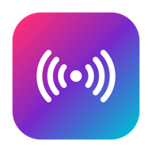
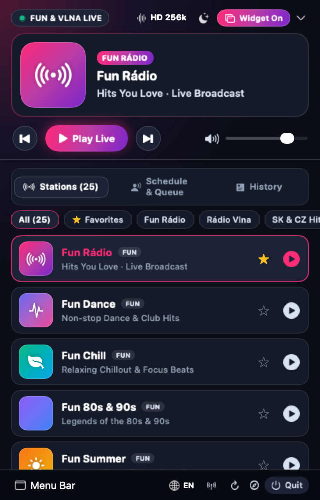
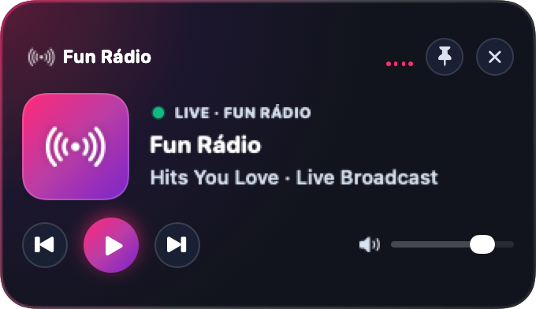

<h1 align="center">FunRadioBar</h1>

Slovak and Czech radio, plus SomaFM, one click from your Mac’s menu bar.

<strong><a href="https://github.com/robo-sk/FunRadioBar/releases/latest/download/FunRadioBar.zip">Download for Mac</a></strong> · <a href="https://github.com/robo-sk/FunRadioBar/releases/latest">Release notes</a> macOS Sonoma 14 or later · Apple silicon and Intel · English and Slovenčina

## On your Mac

<table>
<tr>
<td width="53%" valign="top"></td>
<td valign="top">

### The menu bar player

Click a station to start listening. You can close the panel while the radio plays. Star your favorites to find them again. Open **Schedule &amp; Queue** for upcoming shows or songs when the station provides them.

### The mini player

Keep it on the desktop or pin it above other windows. The moon button in the main player sets a sleep timer.

</td>
</tr>
</table>

## Install

1. Download the latest **[FunRadioBar.zip](https://github.com/robo-sk/FunRadioBar/releases/latest/download/FunRadioBar.zip)**. The app is signed by **itinn s.r.o.** and notarized by Apple.
2. Double-click the ZIP in **Downloads**, then drag **FunRadioBar.app** into **Applications**.
3. Open **FunRadioBar** from Applications. Click the radio icon in the menu bar. Press **Play Live** to listen to the current station, or click another station to play it immediately. Use the speaker slider to adjust the volume independently of the rest of your Mac.

## Stations and updates

| To… | Use… |
| --- | --- |
| See the latest song, listener count and schedule | **Refresh Info** (circular arrow in the footer). |
| Find a seasonal Fun Rádio stream or check availability | **Rescan Stations** (antenna in the footer). Delisted streams disappear after a successful scan. **Show unavailable stations** reveals listed streams that returned an error. |
| Check for a new version of FunRadioBar | **Menu Bar → Check for App Updates…**. Automatic checks are on by default and can be switched off in the same menu. An available update appears in the player so you can choose when to restart. |
| Learn what a control does | Right-click or Control-click the control for its description. |

## Privacy

Favorites, listening history and player settings are stored on your Mac. FunRadioBar contacts broadcasters and metadata providers for streams, artwork, song information and schedules. These servers can see your IP address when contacted, including when the player refreshes information while paused. App update checks contact GitHub. Opening a music or video link takes you to that service.

FunRadioBar is an independent player. Station names identify their respective broadcasters.
